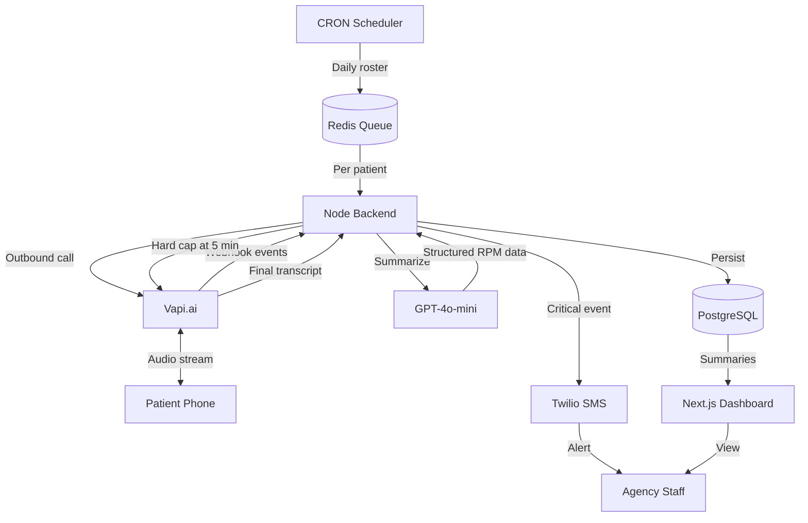

# CareCall: Architecture and Implementation Specification

## Overview

CareCall is a B2B2C telephony AI agent designed for healthcare agencies managing Medicare Remote Patient Monitoring (RPM) programs. It places a daily phone-based check-in to seniors, captures health status information, and escalates urgent issues to staff when needed. The system is built around a strict call-time cap, long pause tolerance, and real-time transcript handling.

## Core Concept

- Makes outbound daily calls without requiring a mobile app.
- Uses a voice-first workflow suited for seniors and low-tech users.
- Applies tailored Voice Activity Detection (VAD) for natural pauses.
- Hard-caps calls to protect margin and enforce compliance.
- Summarizes transcripts into RPM-friendly structured data.
- Sends SMS escalations when a patient reports a concerning event.

---

## Recommended Tech Stack

| Layer              | Recommendation                                          |
| ------------------ | ------------------------------------------------------- |
| Frontend           | Next.js + Tailwind CSS v4 + shadcn/ui                   |
| Backend            | Nest.js                                                 |
| Database           | PostgreSQL + Prisma ORM                                 |
| Telephony          | Vapi.ai (voice agent orchestration)                     |
| SMS                | Twilio                                                  |
| AI summarization   | OpenAI GPT-4o-mini (Structured Outputs)                 |
| Queue / Scheduling | BullMQ + Redis (or pg-boss) for CRON and retries        |
| Hosting            | Railway / Fly.io (backend + worker), Vercel (dashboard) |
| Observability      | Sentry + structured JSON logs (with PII redaction)      |

---

## System Architecture

### Data Flow

1. A CRON job triggers a backend job for a patient roster.
2. The backend initiates an outbound call via the Vapi API.
3. Vapi manages the conversation and streams events to the backend via webhooks.
4. The backend enforces a **5-minute maximum call duration** (hard cap, server-side).
5. After the call ends, the system receives the transcript and recording reference.
6. The backend summarizes the interaction into structured RPM data.
7. Critical responses trigger agency SMS notifications via Twilio.

### Diagram



---

## Project Structure

```text
carecall/
├── dashboard/              # Next.js agency frontend
│   ├── src/
│   │   ├── app/            # Dashboard pages and patient data views
│   │   ├── components/     # UI components
│   │   └── lib/            # Shared frontend utilities
│   └── package.json
├── server/                 # Node.js backend
│   ├── src/
│   │   ├── controllers/    # Vapi webhook and CRON handlers
│   │   ├── services/       # Vapi, Twilio, summarization logic
│   │   ├── models/         # Prisma schema
│   │   ├── jobs/           # Daily scheduling tasks
│   │   └── lib/            # Logger, PII redaction, webhook verification
│   ├── prisma/
│   │   └── schema.prisma
│   └── package.json
├── .env.example
└── README.md
```

---

## Data Model

| Model        | Key fields                                                                                                            |
| ------------ | --------------------------------------------------------------------------------------------------------------------- |
| Agency       | `id`, `name`, `contact_number`, `timezone`                                                                            |
| Patient      | `id`, `agency_id`, `name`, `phone_number`, `timezone`, `consent_captured`, `consent_captured_at`                      |
| CallLog      | `id`, `patient_id`, `duration_seconds`, `transcript` (encrypted), `recording_url`, `status`, `started_at`, `ended_at` |
| DailySummary | `id`, `patient_id`, `date`, `medication_taken`, `pain_level`, `mood`, `notes`, `escalation_triggered`                 |

> 🔒 PII (name, phone, transcript) must be encrypted at rest. Access controlled by `agency_id`.

---

## API Specification

- `POST /api/webhooks/vapi` — receive call status and transcript updates (signature-verified).
- `POST /api/webhooks/twilio` — receive SMS delivery/status callbacks (signature-verified).
- `POST /api/patients` — register a patient from the agency dashboard.
- `GET /api/patients/{id}/summaries` — fetch RPM summaries for billing and reporting.
- `POST /api/calls/trigger` — manually trigger an outbound call for testing.
- `GET /api/calls/{id}` — call detail with transcript + structured summary.
- `GET /api/health` — liveness/readiness.

**Auth:** Agency staff authenticate via Supabase Auth (or NextAuth). All queries scoped by `agency_id`. Webhooks authenticated by provider signature (Vapi HMAC, Twilio `X-Twilio-Signature`).

---

## AI Implementation

- Configure Vapi endpointing with a **silence timeout of at least 5000 ms** (`assistant.voice.endpointing`).
- Begin the system prompt with a **proper disclosure statement** for the recorded line.
- After the call, summarize the transcript into structured RPM answers and billing-relevant fields.
- Use GPT-4o-mini with **Structured Outputs** to extract exact yes/no answers and routine health updates:

```json
{
  "medication_taken": true,
  "pain_level": 0,
  "mood": "good",
  "concerning_events": [],
  "escalation_required": false,
  "notes": "Patient reports feeling well. No complaints."
}
```

### Escalation Rules

- Trigger SMS to agency staff when `escalation_required === true`.
- Trigger on keyword fallback (e.g., "fell", "chest pain", "can't breathe") **in addition to** LLM output — never rely on the LLM alone for safety-critical paths.
- Escalations are idempotent: one SMS per patient per day unless severity increases.

---

## Security and Environment Management

- **Never log PII** in standard application logs. Use a redaction layer.
- Keep all credentials in environment variables.
- Use **secure webhook validation** for Twilio (`X-Twilio-Signature`) and Vapi (HMAC).
- Encrypt transcripts and recordings at rest.
- Enforce `agency_id` scoping on every query.
- Document and honor patient consent capture; store `consent_captured_at`.

### `.env.example`

```env
# --- Database ---
DATABASE_URL=postgresql://...

# --- Queue ---
REDIS_URL=redis://...

# --- Vapi ---
VAPI_API_KEY=...
VAPI_PHONE_NUMBER_ID=...
VAPI_WEBHOOK_SECRET=...

# --- Twilio ---
TWILIO_ACCOUNT_SID=...
TWILIO_AUTH_TOKEN=...
TWILIO_PHONE_NUMBER=...

# --- OpenAI ---
OPENAI_API_KEY=...
OPENAI_SUMMARY_MODEL=gpt-4o-mini

# --- App ---
NODE_ENV=development
LOG_LEVEL=info
CALL_HARD_CAP_SECONDS=300
VAD_SILENCE_TIMEOUT_MS=5000
```

Validate config at startup using `zod`.

---

## Best Practices

- Add a **hard-coded 5-minute kill switch** at the backend **and** telephony layer. Never rely on the voice model to hang up.
- Use **exponential backoff** for failed outbound attempts (max 3 retries).
- Keep the patient-facing script **simple and clear** for elderly callers.
- Validate webhook reliability — third-party telephony services can drop or retry events. Handlers must be **idempotent**.
- Time-zone aware scheduling: only call during the patient's local daytime window (e.g., 9am–6pm).
- Respect quiet hours and DNC lists.
- Prefer Server Components on the dashboard; keep real-time call monitoring as a thin client island.

---

## Development and Deployment

- Use **ngrok** during local development for webhook testing.
- Deploy the backend to a **stable runtime with predictable latency** (not serverless edge for webhook handlers — use a long-lived Node process).
- Keep Vapi and Twilio integrations isolated behind **service-level abstractions** so providers can be swapped.
- Run the CRON scheduler as a dedicated worker process (BullMQ repeatable jobs or pg-boss).

---

## Testing and Quality Checks

- Simulate a **full 6-minute call** to confirm the hard cap terminates correctly at 5 minutes.
- Test emergency transcripts such as **"I fell down"** to confirm SMS escalation triggers.
- Verify that the voice prompt **handles silence** without interrupting the patient.
- Test webhook **replay/idempotency** — duplicate events must not create duplicate summaries or SMS.
- Test failed-call backoff and retry logic.
- Verify time-zone scheduling does not call patients outside their local window.
- Load-test the webhook endpoint for burst traffic.

---

## Implementation Plan

### Phase 1

- Set up the database and agency dashboard.

### Phase 2

- Build the Node.js backend with Vapi and Twilio integrations.

### Phase 3

- Configure Vapi behavior, prompt flow, and call triggers.

### Phase 4

- Add post-call summarization and dashboard population.

### Phase 5

- Enforce the hard cap and escalation logic in production conditions.

---

## Claude Code Instructions

**CRITICAL — Read Before Executing Anything:**

1. **DO NOT create, scaffold, or generate the project files yourself.** This document is an architecture spec. The human user will build the project.
2. **DO NOT run scaffolding commands** (`create-next-app`, `npm install`, `prisma init`, `ngrok`, `vercel`, etc.) on your own initiative.
3. **DO NOT write boilerplate project structure to disk** unless the user explicitly asks for a specific file at a specific path.
4. **Provide the user with a clear, ordered list of commands they will run one-by-one themselves** to set up the project properly. Wait for the user to confirm success after each step before moving to the next.
5. When the user asks "what's next?", give **exactly one command** (or one tightly-scoped step) and stop — let them execute and report back.

**When the user explicitly asks you to write code for a specific module:**

1. **Review the Vapi documentation carefully**, especially `assistant.voice.endpointing` settings and webhook event schemas.
2. **Do not rely on client-side or model-side logic to enforce the final call cutoff.** The 5-minute hard cap must be enforced server-side (and redundantly at the telephony layer).
3. **Treat webhook handling as a critical reliability path.** Handlers must be idempotent, signature-verified, and safe against retries and out-of-order events.
4. **Keep the voice timing and silence behavior tuned for senior callers** — longer endpointing, no interruptions, clear phrasing.
5. **Never log PII.** Use the redaction layer for all logs touching patient data.
6. **Never rely on the LLM alone for safety-critical escalation.** Combine keyword fallback with LLM output.
7. Use **Structured Outputs** for the GPT-4o-mini summarization call — never free-form parsing.
8. Encrypt transcripts and recordings at rest; scope all queries by `agency_id`.
9. Use exponential backoff for outbound retries; cap at 3 attempts.
10. Respect the patient's timezone and quiet hours when scheduling calls.

**General Principles for All Responses:**

- Enforce type safety end-to-end; validate env vars with `zod`.
- All secrets come from environment variables — never hardcode.
- Prefer long-lived Node processes for webhook handlers — no serverless edge for critical paths.
- When suggesting commands, give them **one at a time** and wait for confirmation.

---

## Definition of Done

- [ ] Agency staff can add a patient and phone number from the UI.
- [ ] A CRON job successfully initiates outbound calls through Vapi.
- [ ] The AI discloses the call, pauses appropriately, and collects responses.
- [ ] Calls terminate forcefully at **5 minutes**.
- [ ] Transcripts are summarized and displayed to the agency.
- [ ] An SMS is sent when the patient reports being unwell.
- [ ] Webhook handlers are idempotent and signature-verified.
- [ ] PII is redacted from all application logs.
- [ ] Failed calls retry with exponential backoff (max 3 attempts).
- [ ] Scheduling respects patient timezone and quiet hours.

---

## Notes

This product operates in a **regulated, safety-critical domain**. Reliability, privacy, and auditability matter more than feature velocity. Every design decision should be defensible to a compliance reviewer and to the agency's clinical staff.
